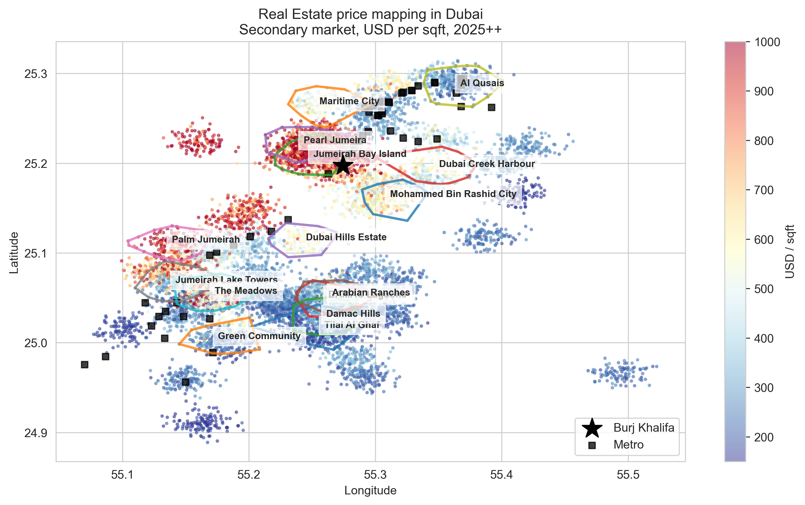
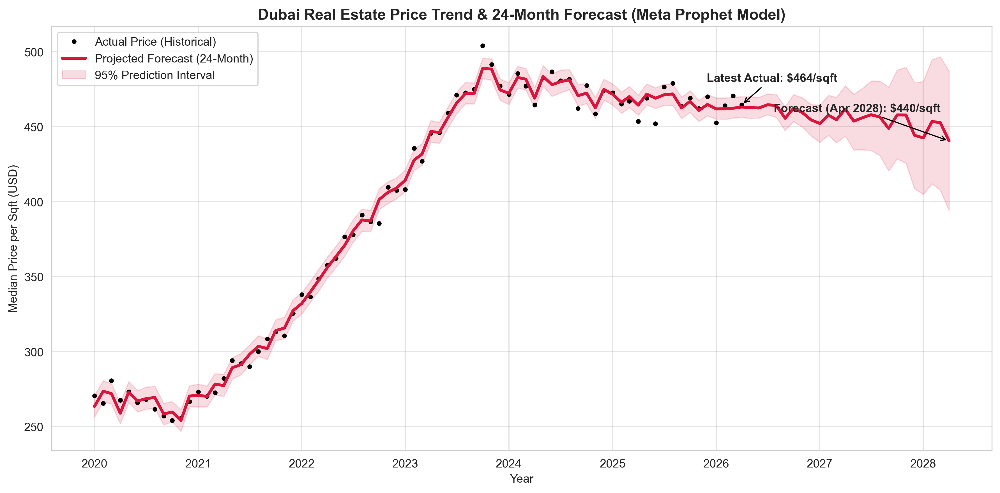
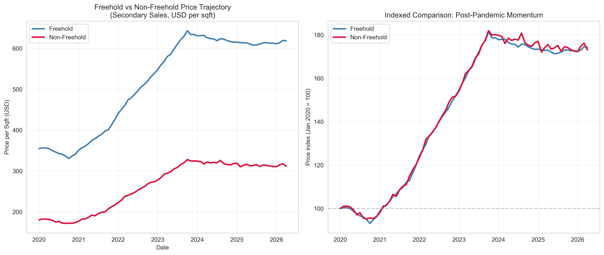
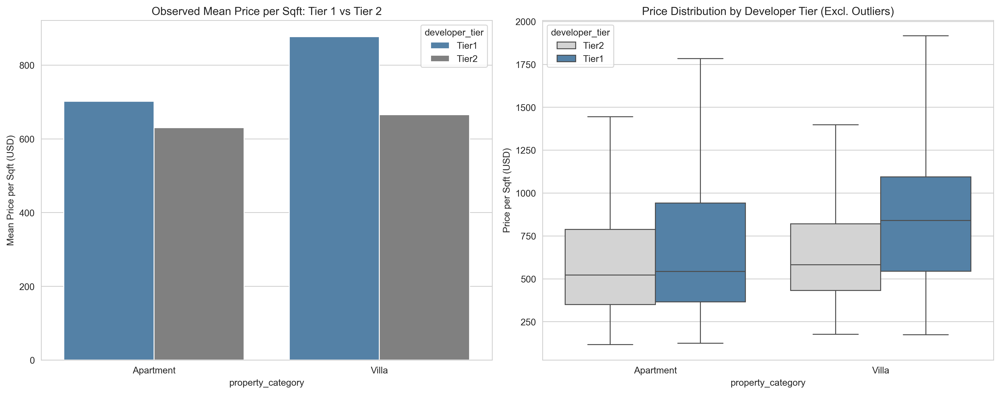

# 🏙️ Dubai Real Estate Market Analysis (2020–2026)

[](https://dubai-real-estate-fathir.streamlit.app/)
An end-to-end data science and exploratory data analysis (EDA) project analyzing the Dubai real estate market. This project incorporates data-driven investment analysis, statistical hypothesis testing, time series forecasting using **Meta Prophet**, and an interactive, premium dark-themed **Streamlit Dashboard**.

---

## 📊 Project Overview

This project analyzes a comprehensive dataset of Dubai real estate listings and community aggregates spanning from **January 2020 to April 2026**. The goal is to uncover key factors influencing property valuation, evaluate investment returns (rental yields), quantify segment premiums, and project price trends 24 months into the future (mid-2028).

The analysis leverages five main datasets (obtained via Kagglehub):
1. **Area Prices Monthly:** Community-level monthly indicators (prices, rental rates, mortgage rates, freehold status).
2. **Metro Stations:** Geographic locations and details of Dubai Metro stations.
3. **Secondary Sales:** Listings of ready resale residential properties.
4. **Off-Plan:** Listings of pre-construction properties.
5. **Rentals:** Listings of active residential rental contracts.

---

## 🔑 Key Analytical Insights

### 1. Spatial & Geographic Dynamics
* **Distance Decay:** Properties within **0–5 km of the Burj Khalifa** command a massive price premium, average secondary prices exceeding **$600 to $800/sqft**. Prices decay exponentially as distance increases, stabilizing at a baseline of **$200/sqft** past 15 km.
* **Transit-Oriented Development (TOD):** Properties within **0–2 km of a Metro station** command a substantial premium due to enhanced connectivity, which is highly valued by tenant populations.

### 2. Freehold vs. Non-Freehold Trajectory (With Statistical Validation)
* **Performance:** Freehold communities consistently trade at a premium of **$150–$200/sqft** over non-freehold areas.
* **Growth:** The indexed price trajectory (Jan 2020 = 100) shows that freehold areas captured almost all of the 2021–2026 post-pandemic market rally.
* **Statistical Test:** An independent Welch's t-test comparing freehold and non-freehold community-month prices rejects the null hypothesis ($p < 0.05$), statistically proving that freehold status (permitting 100% foreign ownership) commands a significant market premium.

### 3. Investment & Developer Pricing (Feature Engineering)
* **Rental Yields:** Calculated annual gross rental yields across zones:
  $$\text{Rental Yield} = \frac{\text{Annual Rent per Sqft}}{\text{Secondary Price per Sqft}} \times 100$$
  Suburban/affordable zones (e.g., **Deira**, **Reem**, **Tilal Al Ghaf**) offer the highest gross rental yields (**~6.5%**), while luxury coastal zones (e.g., **Palm Jumeirah**) trade yields for long-term capital appreciation (**~3.5%–4.5%**).
* **Developer Brand Premium:** Tier 1 developers (e.g., Emaar, Nakheel) command a clear price premium in the off-plan market: **+11.4% premium** for apartments and a massive **+31.9% premium** for villas.
* **Off-Plan Price Gap:** Off-plan properties sell at a consistent **9% to 11% premium** per square foot compared to ready resale units in the same zone.

### 4. Advanced Price Forecasting
* Replacing standard linear trends with a seasonal **Meta Prophet Model** successfully captures annual market seasonality.
* Median secondary price is projected to experience healthy cyclical fluctuations and stabilize around **$440/sqft by mid-2028**.
* Time-series components show that Dubai's real estate market exhibits high demand spikes around **Q4 and Q1** (winter tourism season) and minor cooling during **Q3** (summer).

---

## 📸 Sample Visualizations

Here is a glimpse of the premium visualizations generated in this analysis:

<p align="center">
  <br>
  <em>Geospatial distribution of secondary market prices across Dubai (Top 15 Zones)</em>
</p>

<p align="center">
  <br>
  <em>24-Month Meta Prophet Price Forecasting Model</em>
</p>

<p align="center">
  <br>
  <em>Price trajectory and indexed performance of Freehold vs Non-Freehold communities</em>
</p>

<p align="center">
  <br>
  <em>Off-Plan developer brand equity and premium pricing analysis</em>
</p>

---

## 🖥️ Interactive Streamlit Dashboard

To complement the Jupyter Notebook analysis, a production-grade, dark-themed Streamlit dashboard is included in `app.py`.

### Features:
1. **Market Overview:** Core KPI cards (listings count, median prices, mortgage rate trends) and a dynamic geographic Mapbox plot highlighting:
   * Property listings bubble map colored by price per sqft.
   * **Burj Khalifa** highlighted with an iconic gold marker.
   * **Dubai Metro Red & Green lines** overlay.
2. **Yield & Opportunity Analysis:** Dynamic visualizations of rental yields and off-plan gap percentages across zones.
3. **Developer Brand Equity:** Toggled comparisons of Tier 1 vs. Tier 2 pricing and an interactive cost calculator for off-plan units.
4. **Price Forecasting Explorer:** Interactive forecasting tab allowing users to adjust the prediction horizon (months ahead) and view decomposed trend/seasonality curves on-the-fly.

---

## 🛠️ Tech Stack

* **Language:** Python 3.8+
* **Data Processing:** `pandas`, `numpy`
* **Modeling & Statistics:** `prophet`, `scipy`, `statsmodels`
* **Data Visualizations:** `matplotlib`, `seaborn`, `plotly`
* **Dashboard Framework:** `streamlit`

---

## 🚀 Getting Started

### 1. Installation

Clone the repository and install the required packages:
```bash
pip install -r requirements.txt
```

### 2. Run the Notebook
Open and execute the cells in `main.ipynb` to view the comprehensive EDA, visualizations, statistical tests, and Prophet forecasting pipeline:
```bash
jupyter notebook main.ipynb
```

### 3. Run the Dashboard
To start the interactive Streamlit application locally:
```bash
streamlit run app.py
```
This will start a local web server (usually at `http://localhost:8501`) and open the application in your default web browser.

---

## 📂 Project Structure

```text
Dubai Real Estate (2020-2026)/
├── main.ipynb                          # Core EDA, statistical tests, and Prophet forecasting notebook
├── app.py                              # Streamlit interactive dashboard application
├── requirements.txt                    # Python package dependencies
├── .gitignore                          # Git ignore file
├── README.md                           # Project documentation
├── plots/                              # High-resolution exported visualization charts
│   ├── real_estate_dubai_price_map.png
│   ├── price_trend_forecasting_prophet.png
│   ├── developer_tier_premium_analysis.png
│   └── ...
└── *_Explanation.md                    # Detailed markdown schemas for each dataset (e.g., rentals, off_plan)
```